<div align="center">



# Shoubhik Bhattacharya — Portfolio 2026

**A futuristic, game-menu style portfolio with a real-time 3D hero.**
Game design · Technical art · Unreal Engine 5 · Unity 6 · Blender


</div>

---

## ✦ Highlights

|              |                                                                                                                                                                                                                      |
| ------------ | -------------------------------------------------------------------------------------------------------------------------------------------------------------------------------------------------------------------- |
| **3D hero**  | A Three.js scene with a GLB character on a glowing platform. It follows the cursor, can be dragged to rotate, pauses off-screen, and honours `prefers-reduced-motion`.                                               |
| **Projects** | One shared card grid with category filters (Game Development, Technical Art & 3D, VR / AR, Web & Interactive) plus a **Showreel** tab. Each project opens a full case-study popup with a system-architecture viewer. |
| **Showreel** | Video cards in the same grid, played in a modal. Missing clips show a tidy placeholder instead of a broken player.                                                                                                   |
| **Contact**  | A validated form sent through [Web3Forms](https://web3forms.com): loading, success and error states; the form is only cleared after a confirmed success.                                                             |
| **Polish**   | Film-grain texture, angled panel corners, smooth active-section nav, accessible focus states, responsive from phone to 1920px.                                                                                       |

## ✦ Sections

`Home` → `About` → `Skills` → `Projects` (+ `Showreel`) → `Experience` → `Education & Certificates` → `Contact`

## ✦ Run locally

No build step. ES modules need a server (opening `index.html` from disk won't work):

```bash
npx http-server . -p 8123
```

Then open <http://localhost:8123>.

## ✦ Project structure

```text
.
├── index.html              page shell and section markup
├── styles/                 base.css (tokens, header) · hero.css · sections.css · projects.css
├── src/
│   ├── main.js             entry point
│   ├── data/
│   │   ├── projects.js     all projects (and each popup's content)
│   │   ├── showreel.js     showreel clips
│   │   └── profile.js      bio, skills, experience, education, links, Web3Forms config
│   ├── hero/               Three.js scene, character loader and character.config.js
│   └── modules/            projects, showreel, sections, contact, nav / reveal
├── assets/
│   ├── models/             character.glb (hero 3D character)
│   └── readme/             README banner
├── public/
│   ├── documents/          resume PDF
│   ├── images/
│   │   ├── profile/        portrait, pixel avatar
│   │   ├── projects/<id>/  cover + gallery images, one folder per project
│   │   ├── diagrams/       system-architecture diagrams
│   │   ├── certificates/   certificate images
│   │   └── textures/       film grain
│   └── showreel/           showreel videos and thumbnails
├── vendor/three/           Three.js r170 + GLTF / FBX loaders
└── vercel.json
```

## ✦ Content guide

<details>
<summary><b>Add a project</b></summary>

1. Put images in `public/images/projects/<project-id>/` (a `cover` image plus any gallery images).
2. Append an object to `projects` in `src/data/projects.js`. The field list is documented at the top of that file.

Every project has exactly one primary `category` (`game`, `art`, `vr` or `web`). Filters and counts update automatically.

</details>

<details>
<summary><b>Add showreel clips</b></summary>

1. Put videos and 16:9 thumbnails in `public/showreel/`.
2. Add `{ title, description, thumbnail, videoSrc }` entries to `src/data/showreel.js`.

Clips appear when the **SHOWREEL** filter is selected. A missing file shows an "Add video file" placeholder card.

</details>

<details>
<summary><b>Swap the 3D character</b></summary>

1. Put a `.glb` (preferred) or `.fbx` in `assets/models/`.
2. Edit `src/hero/character.config.js`: set `model`, `targetHeight` and, if needed, `rotationY`.

The loader scales and centres the model, plays an idle clip if one exists, and falls back to a built-in stand-in if loading fails. See `assets/models/README.md` for the FBX → GLB workflow.

</details>

<details>
<summary><b>Contact form / resume</b></summary>

- Web3Forms endpoint and access key live in `src/data/profile.js` (`web3forms`). The recipient is configured in the Web3Forms dashboard for that key.
- The resume path is `profile.resume` in the same file; both the hero **RESUME** and the contact-form **RESUME** buttons use it.
</details>

## ✦ Deploy

Static site, deploys to **Vercel** as-is (`vercel.json` serves the repository root). Any static host works.

## ✦ Connect

[GitHub](https://github.com/Shoubhik95) · [LinkedIn](https://www.linkedin.com/in/shoubhik-bhattacharya-8b4099324) · [ArtStation](https://www.artstation.com/gamedev_shoubhik2) · [Itch.io](https://shoubhik-bhattacharya.itch.io/)

---

<div align="center"><sub>© 2026 Shoubhik Bhattacharya. </sub></div>
